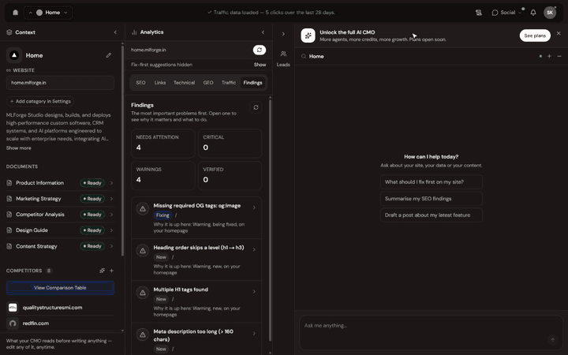
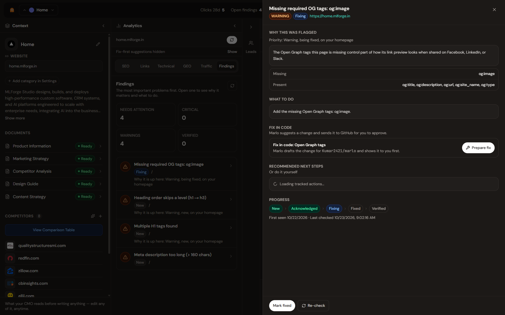
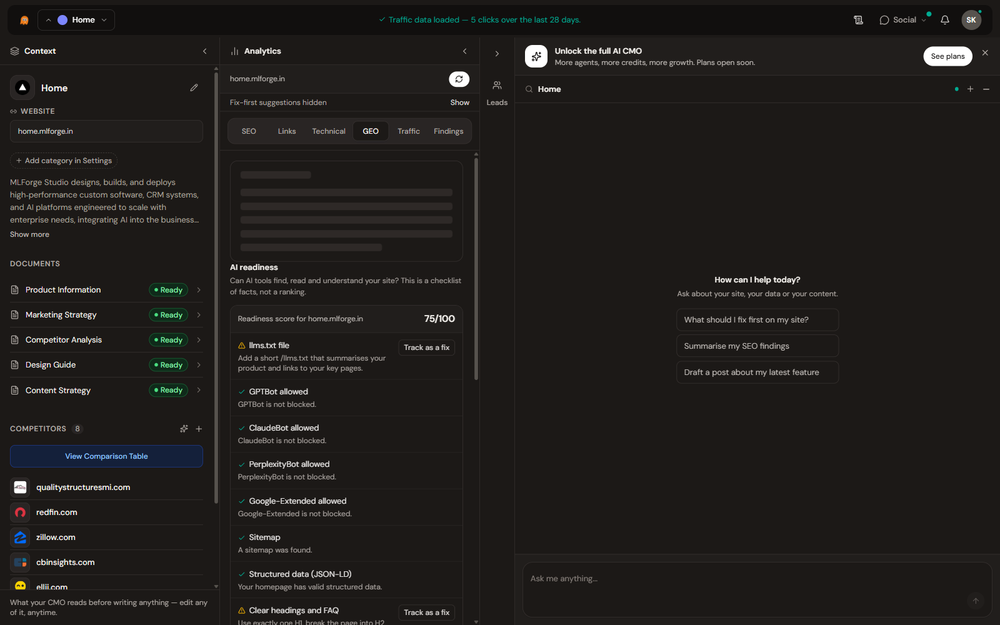
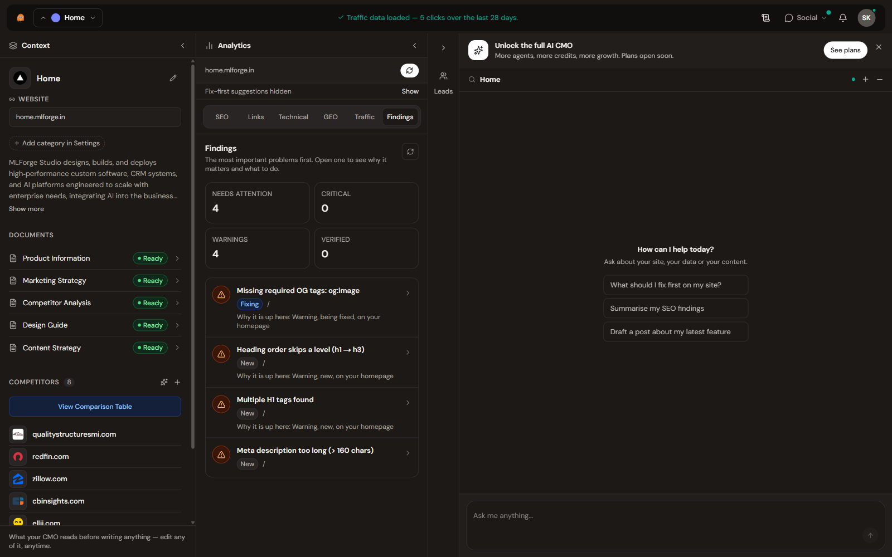
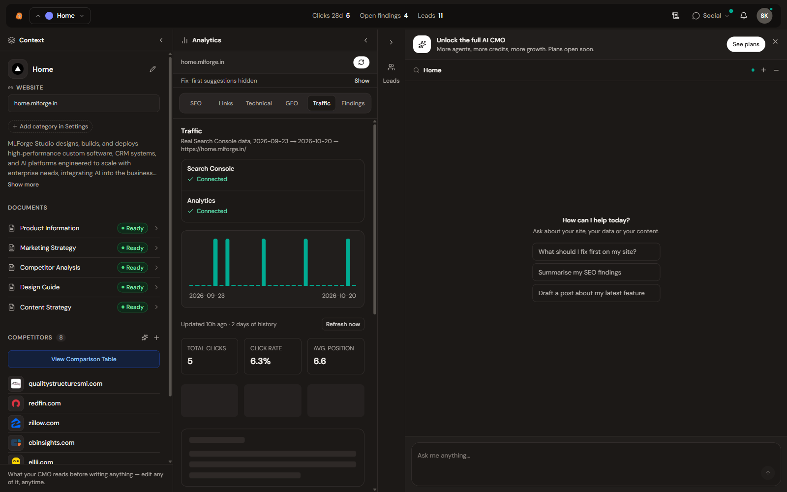
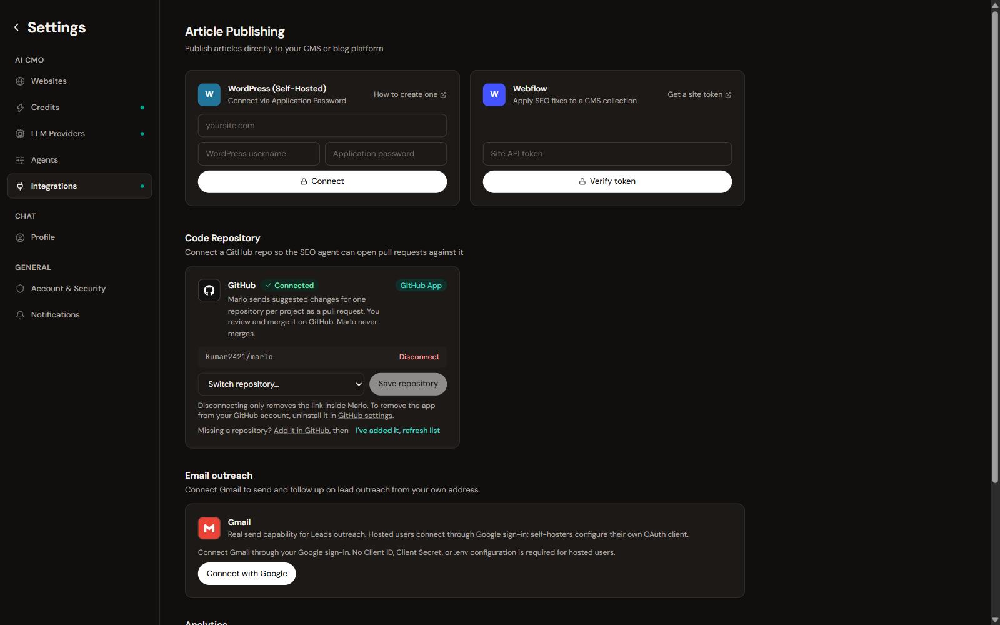
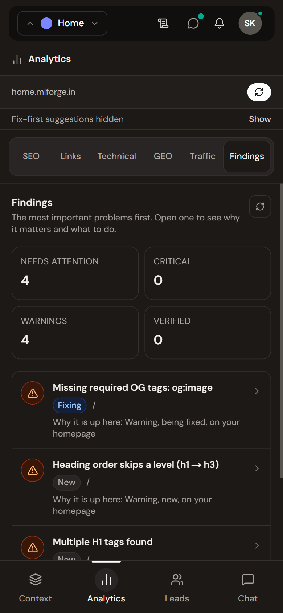
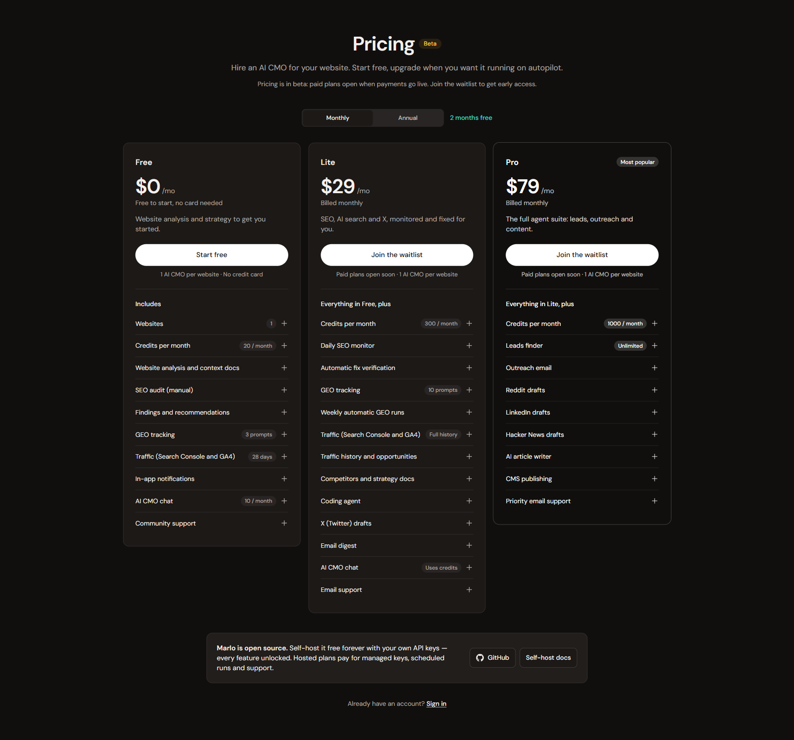
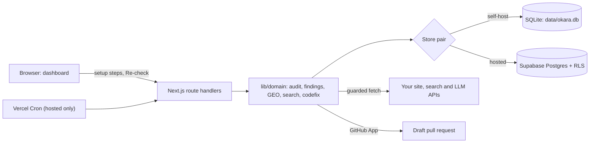
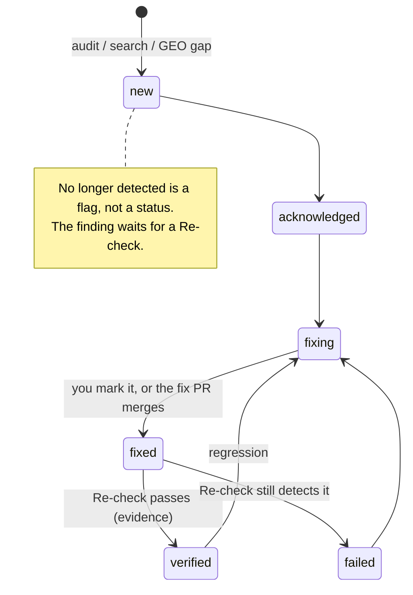

<div align="center">


**Open-source AI CMO. Marlo audits your website, finds what's holding it back in search and AI answers, helps you fix it, and only calls a fix verified when it has evidence.**

[](https://github.com/Kumar2421/okara-alternative/actions/workflows/ci.yml)
[](./LICENSE)
[](docs/plans-and-pricing.md)
[](https://app.marlo.mlforge.in)

[Hosted app](https://app.marlo.mlforge.in) · [Self-host](#self-host) · [Docs](docs/README.md) · [Pricing (beta)](https://app.marlo.mlforge.in/pricing) · [Changelog](CHANGELOG.md)



</div>

Marlo is one Next.js app. Use the hosted version, or self-host it for free with your own API keys. Self-host has every feature unlocked and no plan limits.

Marlo is inspired by [Okara](https://okara.ai). It is an independent project: not affiliated with or endorsed by Okara, and not derived from Okara's code.

## What Marlo does

Marlo runs one loop: **discover → understand → act → verify**. "Verified" always means evidence: a later audit, a re-check, or a real AI-answer run. A click alone never verifies anything.

| Step | What happens | |
|---|---|---|
| **Discover** | You add a website. Setup audits the homepage, writes a description, finds competitors, and drafts Context documents (product info, marketing strategy, competitor analysis, content strategy, design guide). Progress is saved per project, and setup resumes when you come back. |  |
| **Understand** | Issues become **findings**, ranked by impact. The **Fix first** strip shows the top ones. Each finding has its evidence, why it matters, and a recommendation that matches the issue. The Traffic tab (Search Console, GA4) and GEO tracking add search and AI-answer context. |  |
| **Act** | Mark a finding as in progress, ask the coding agent to open a **draft** GitHub pull request through the GitHub App, or publish a reviewed change to WordPress or Webflow. You approve every external write. Nothing posts or merges by itself. |  |
| **Verify** | **Re-check** runs the real check again, either when you click it or automatically on hosted. A finding that a newer audit no longer reports is flagged **No longer detected** and stays open until a re-check proves it. A GEO gap closes only when a later real run names you. |  |

<details>
<summary>More screenshots</summary>

| | |
|---|---|
|  |  |
| Dashboard | Traffic (Search Console and GA4) |
|  |  |
| Setup progress, saved per project | Integrations |
|  |  |
| Mobile | Pricing (beta) |

</details>

## Status

Marlo is in beta. This table says what to rely on today.

| Area | State | Notes |
|---|---|---|
| SEO audit | Stable | Audits one page in depth. The site crawl on the Links tab samples up to 8 pages, one link deep from the homepage. PageSpeed scores need a PageSpeed key; without one, the audit says "Not measured" rather than guessing. |
| Findings lifecycle and Re-check | Beta | Manual Re-check everywhere. Automatic re-check runs only on hosted, because it uses the scheduled jobs. A failed or skipped check never marks anything verified. |
| No longer detected | Beta | When a newer audit of the same page stops reporting an issue, the finding is flagged. It is never verified automatically. |
| Fix first strip | Beta | Shows the top open findings in a predictable, explainable order. |
| Context documents | Beta | Generated with an LLM from your site and web search. Treat them as drafts. |
| Traffic (Search Console, GA4) | Beta | Needs Google OAuth. Hosted takes a daily Search Console snapshot. Self-host refreshes manually. |
| GEO tracking | Beta | A real Gemini answer grounded in Google Search ("real"), or a labelled stand-in built from Tavily and Groq ("simulated"). The two are never mixed or counted together. Marlo does not query ChatGPT, Perplexity or Claude. |
| GEO gaps as findings | Beta | A prompt that keeps missing you becomes a finding. It closes only when a later run of the same prompt and method names you. |
| GitHub fix PRs | Beta | Hosted uses a GitHub App. Self-host uses a token you save in Settings. PRs open as drafts, and no code path merges them. |
| Resumable setup | Beta | Progress is saved per project and resumes when you return. Setup runs in your browser, so it does not continue after you close the tab. On hosted it needs migration `20261022000300_project_setup_state.sql`. |
| Notifications | Beta | In-app bell. Email only when Resend is configured. |
| AI CMO chat | Beta | Read-only tools over your project data, scoped to the active project and run under your own session. Marlo picks the model and retries on a backup model if a request fails. Chats are saved on the server for 90 days, and you can delete one or all. Monthly message limits are built but off during beta. Starting an audit from chat is not available yet. |
| CMS publish (WordPress, Webflow) | Experimental | You preview and approve every write. WordPress SEO fields need Yoast or Rank Math REST meta. Webflow field names have not been checked against live sites. |
| Leads, outreach and social drafts | Experimental | People search needs Tavily. Gmail outreach uses your own Gmail account. X, LinkedIn and Reddit posts are drafts: "Post" opens the network's compose page. Local business search is "Coming soon" on hosted and works on self-host with your own Google Cloud key. |
| Plans and pricing | Beta | Free, Lite and Pro are defined, but there is no payment gateway yet and enforcement is off. See [Plans and pricing](#plans-and-pricing). |

## Hosted or self-host

| | Hosted ([app.marlo.mlforge.in](https://app.marlo.mlforge.in)) | Self-host (this repo, SQLite) |
|---|---|---|
| Cost | Free during beta. Lite and Pro have a waitlist at [/pricing](https://app.marlo.mlforge.in/pricing) | Free (AGPL-3.0) |
| Plan limits | Plan enforcement is off. Older safety caps still apply: 4 websites and 10 daily leads on the Free tier, and per-user daily GEO caps (20 real Gemini runs, 60 simulated runs) | None |
| Sign-in | Supabase Auth (email and password with a one-time code; Google sign-in when enabled) | None. It is a single-user local app. Do not expose it to the internet |
| Data | Supabase Postgres with row-level security | `data/okara.db` (SQLite) on your machine |
| API keys | Platform-managed default models, or bring your own key | Your own keys, saved in Settings |
| Scheduled jobs | Daily Search Console snapshots, automatic re-checks, daily leads refresh, weekly GEO runs | None. The cron routes are hosted-only. Refresh and re-check by hand |
| GitHub fixes | GitHub App, draft PRs | Personal token, draft PRs |
| Local business leads | Coming soon | Yes, with a Google Cloud key that has Places API (New) enabled |

You can also run the hosted build on your own Supabase project. See [docs/self-hosting.md](docs/self-hosting.md#option-b-your-own-supabase).

## Quick start

### Self-host

Requires **Node.js 24.12 or newer** (`engines` in `package.json`) and git.

```bash
git clone https://github.com/Kumar2421/okara-alternative.git
cd okara-alternative
npm install
echo "NEXT_PUBLIC_SELF_HOST=true" > .env.local
npm run dev
```

1. Open **http://localhost:3000/dashboard**. The root URL redirects to the hosted sign-in page, which needs Supabase.
2. To check the setup, open `http://localhost:3000/api/system/storage-diagnostics`. You should see `"storageMode":"sqlite"` and `"available":true` under `sqlite`.
3. In **Settings → LLM Providers**, add at least one model key. The providers with drivers are Anthropic, OpenAI, Google, Mistral and Groq, plus a local Ollama or LM Studio server or any other OpenAI-compatible endpoint. Add optional keys under **Settings → API Credentials**: Tavily for web search, PageSpeed, Gemini for real GEO answers, Google Cloud, and a GitHub token for fix PRs.
4. Add your website. Setup runs while the tab is open.

No environment variables are required in self-host mode. Optional ones, such as Gmail OAuth or Resend email, are listed in [docs/environment.md](docs/environment.md). For a production-style build, run `npm run build` and then `npm start`. For full steps and troubleshooting, see [docs/self-hosting.md](docs/self-hosting.md).

### Hosted

Sign up at **https://app.marlo.mlforge.in**. To run your own hosted deployment (Supabase and Vercel), follow [docs/hosted-setup.md](docs/hosted-setup.md) and [docs/self-hosting.md](docs/self-hosting.md#option-b-your-own-supabase).

## How it works



- **One app, two modes.** `lib/features.ts` chooses the mode. Self-host uses SQLite. Hosted uses Supabase, and a hosted deployment with missing Supabase config fails closed with HTTP 503.
- **Store pairs.** Each domain store has a SQLite file and a Supabase file, for example `findingStore.ts` and `findingStoreSupabase.ts`. The domain logic above them is shared and mostly pure.
- **Finding lifecycle.** `new → acknowledged → fixing → fixed → verified | failed`. Only evidence sets `verified` or `failed`: a Re-check, the automatic check, or a later GEO run. You cannot set them by hand.



For data flow, cron jobs, the GitHub App loop and setup state, see [docs/architecture.md](docs/architecture.md).

## Security

- **Auth.** Supabase Auth. Server routes verify the user with `auth.getUser()` and do not trust a client-side session.
- **Isolation.** Row-level security on user tables. Server-trusted tables (profiles, settings, connections) are read-only to users. Project routes check that the signed-in user owns the project.
- **Outbound requests.** URLs that users can influence go through one guarded fetcher. It pins DNS, blocks private addresses, re-checks every redirect hop, and caps time and body size.
- **OAuth.** Google, Gmail and GitHub connect flows use a single-use, expiring `state` value. On hosted, only the user who started a flow can complete it. Email unsubscribe links use signed, expiring HMAC tokens.
- **Keys.** The operator's provider keys are never sent to a base URL that a user supplied ([#170](https://github.com/Kumar2421/okara-alternative/pull/170)).
- **External writes.** Fix PRs and CMS publishes need a signed, expiring approval. PRs are drafts, and nothing auto-merges or auto-posts.
- **Cron routes** require a `CRON_SECRET` bearer token, compared in constant time.
- The Content-Security-Policy header is still **report-only**.

Read [docs/security.md](docs/security.md) for details. To report a vulnerability, follow [SECURITY.md](SECURITY.md) and use GitHub private vulnerability reporting, not a public issue.

## Plans and pricing

Hosted plans are **Free, Lite and Pro, per website**, and they are in **beta**. There is no payment gateway yet, so the paid plans have a waitlist at [/pricing](https://app.marlo.mlforge.in/pricing). The suggested beta prices are **Lite $29/month ($24/month billed annually)** and **Pro $79/month ($66/month billed annually)**. Plan enforcement is off, so the plan limits are not active and hosted features are unlocked today. Self-host is always unlocked.

The full feature and limit matrix, generated from `lib/domain/plans/planMatrix.ts`, is in [docs/plans-and-pricing.md](docs/plans-and-pricing.md).

## Roadmap and known limits

Coming next, in order: finish the core loop (findings, re-check, GEO gaps), then audit depth, then hardening. Known limits today:

- **Setup runs in your browser.** Progress is saved and resumes when you return, but setup does not continue while the tab is closed.
- **Shallow crawl.** The audit covers 1 page and samples up to 8. A full crawl of hundreds of pages is not built.
- **Scheduled jobs have limited coverage.** Each cron is one time-boxed run per day (GEO: per week), so a large fleet of sites is covered slowly.
- **Payments are not live.** Plan limits are defined but not enforced.
- **Limited GEO engines.** Marlo measures Gemini grounded answers only, and labels the simulated stand-in as simulated.
- **No automatic posting** to X, LinkedIn or Reddit.
- **Lead email checks** use SMTP, which most cloud hosts block, so lead emails often show as unverified on hosted.
- **E2E suite.** The Playwright suite (layout, accessibility, vitals, visual) runs by hand, not in CI, and some accessibility and visual specs fail today.
- **CSP** is report-only.

## Documentation

| Doc | For |
|---|---|
| [docs/README.md](docs/README.md) | Map of all docs |
| [docs/self-hosting.md](docs/self-hosting.md) | Self-host step by step, SQLite or Supabase, cron recipe, troubleshooting |
| [docs/architecture.md](docs/architecture.md) | Data flow, store pairs, crons, GitHub App loop, setup state, finding lifecycle |
| [docs/plans-and-pricing.md](docs/plans-and-pricing.md) | Plan matrix, limits, how enforcement works |
| [docs/security.md](docs/security.md) | Protections and how to report a vulnerability |
| [docs/FAQ.md](docs/FAQ.md) | Common questions |
| [docs/environment.md](docs/environment.md) | Every environment variable |
| [docs/hosted-setup.md](docs/hosted-setup.md) | Hosted deployment checklist |
| [docs/google-cloud-setup.md](docs/google-cloud-setup.md) | Google OAuth and API setup |
| [CHANGELOG.md](CHANGELOG.md) | What changed, by theme |

## Contributing

Issues and pull requests are welcome. The rule for features matches the code: **use real data or say plainly that it is not available. Never show a plausible-looking fake.** If you add a feature, show its empty, loading and error states too.

```bash
npm test          # unit tests (node:test, tests/*.test.mts)
npm run lint      # ESLint
npm run build     # production build
npm run e2e       # Playwright (run `npx playwright install chromium` once first)
```

- **Keep PRs small.** Each PR should solve one problem end to end. Avoid broad refactors and new abstractions without a consumer.
- **CI** ([`.github/workflows/ci.yml`](.github/workflows/ci.yml)) lints the files you changed, runs `npm test` (and fails if no tests ran), and runs a production build. Full-repo lint is informational only.
- **Target `main`.** The `pr-base-guard` job fails a PR whose base is another branch, unless the PR body says `intentional-base`.
- See [docs/acceptance-gates.md](docs/acceptance-gates.md) for the definition of done.

## License

Marlo is licensed under the [GNU Affero General Public License v3.0](./LICENSE). If you run a modified version as a network service, you must make its source available to the people who use it.

